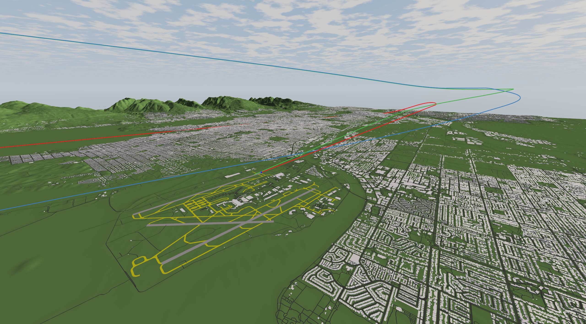
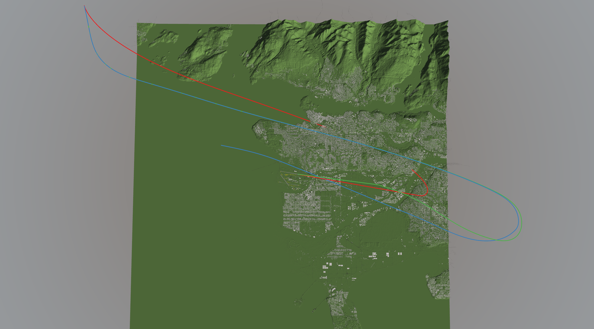
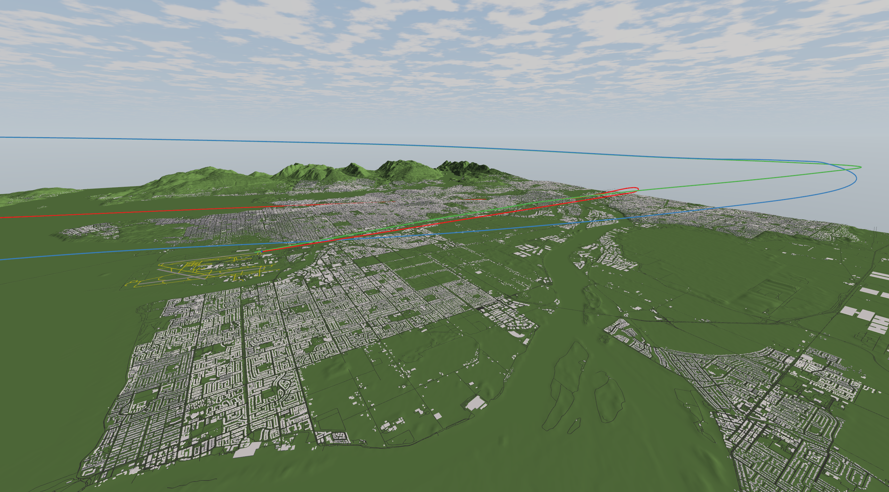
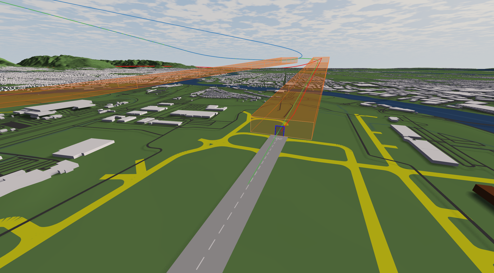

# ApproachNet: Physics-Grounded Safety Layers for Data-Driven Aircraft Approach Control

<table>
  <tr>
    <td colspan="4" align="center"></td>
  </tr>
  <tr>
    <td></td>
    <td></td>
    <td></td>
    <td></td>
  </tr>
</table>

Automated guidance of aircraft through the approach phase typically relies on either
optimal control or neural architectures. This repository implements **ApproachNet**,
a data-driven framework that combines the strengths of both paradigms: it enforces
physical and operational hard constraints while retaining the computational efficiency
of learning-based approaches.

ApproachNet predicts low-level control commands (thrust, load factor, bank) using two
compatible neural backbones - **ResNet-101** and **FT-Transformer** - trained on
historical ADS-B data. Both backbones are additionally used as node encoders of a
**multi-aircraft GNN**, which models the interaction between simultaneously approaching
aircraft. The predictions are grounded in a **aircraft dynamics model** and
projected onto a feasible, safe control set via a differentiable **control barrier
function quadratic program (CBF-QP)** safety layer, which can be applied at inference
only or trained end-to-end. As a classical reference, a **CasADi/IPOPT-based trajectory
optimizer** is included for comparison.

The resulting trajectories are feasible, safe, and computable at interactive rates, and
generalize across multiple airports, runways, and aircraft types.

## Get started

All experiments were conducted with Python 3.13. The exact package versions are pinned in
`src/pyproject.toml` / `src/uv.lock` (recommended, managed with [uv](https://docs.astral.sh/uv/))
and additionally exported to `src/requirements.txt`. PyTorch is installed with CUDA 12.6
from the PyTorch index. For the constraint training, CUDA 12 or 13 and a Linux environment
(or WSL) is needed, otherwise the script will fail with `MOREAU not found`.

1. Create a virtual environment in the src folder of this project, either with uv as the
   package manager (recommended) or with pip and the requirements.txt file:
    1. uv:
    ```bash
            curl -LsSf https://astral.sh/uv/install.sh | sh    # Windows: powershell -c "irm https://astral.sh/uv/install.ps1 | iex"
            cd src
            uv venv --python 3.13
    ```
    2. pip:
    ```bash
            cd src
            python -m venv .venv
    ```
        Windows: ```.venv\Scripts\activate```  
        Linux/macOS: ```source .venv/bin/activate```
2. Install the required packages:
    1. uv: ```uv sync --frozen```
    2. pip: ```pip install -r requirements.txt --extra-index-url https://download.pytorch.org/whl/cu126```
3. Always run the scripts with `src` as the working directory with ```python3``` / ```python``` or ```uv run ...```, either from the console
   (`cd src`) or in PyCharm / VS Code with the working directory set to `src`.
   All paths are relative to `src` (`./data`, `ml/results/...`).
4. If you use the dataset provided with our paper, you can skip the
   [Login / Account requirements](#login--account-requirements) and the
   [Data Retrieval](#data-retrieval) and directly place the data under `src/data`. For that please download
   the dataset from https://huggingface.co/datasets/Justin22122002/ApproachNet and go directly to [Experiments](#experiments).

### Login / Account requirements

1. Copernicus Sentinel-2 (terrain data) -> https://dataspace.copernicus.eu/data-collections/copernicus-sentinel-missions/sentinel-2
    credentials: via a `.env` file in the root folder of this project with the following format
    ```
    COPERNICUS_USERNAME="example@example.com"
    COPERNICUS_PASSWORD="password"
    ```
2. OpenSky Trino Client (historical flight data) -> https://openskynetwork.github.io/opensky-api/trino.html
    see the docs for the credential setup

### Data Retrieval

1. Run ```src/main_load_data.py```. The airport data for the following experiments
   will be saved under ```src/data```.
2. Run ```src/utils/clients/open_sky_trino_client.py```.
    Note: the number of arrivals can be adjusted via the `target_n_arrivals_train` and
    `target_n_arrivals_test` parameters. Depending on the size of the flight data, this
    can take multiple hours up to days.

### Experiments

The recommended way is the pipeline script (see [Run the full pipeline](#run-the-full-pipeline)),
which trains and evaluates all models in the right order and passes the result folders
automatically. All scripts can also still be run individually (console or IDE).

Every model is saved under `src/ml/results/<model>/<timestamp>/` (e.g.
`best_model.pth`, `last_model.pth`, normalization stats, metrics, training plot).
The timestamp folder name identifies the run and is used to link dependent trainings
and evaluations.

#### Training

Set `dataset_name` in the scripts to the name of the downloaded train Trino dataset.
The scripts must be run in this order, because the constraint models are warm-started
from the corresponding base models:

| Step | Scripts | Depends on |
|------|---------|------------|
| 1 | `ml/train_ft_transformer_next_state_all_airports.py`, `ml/train_resnet_101_next_state_all_airports.py` | – |
| 2 | `ml/train_ft_transformer_all_airports.py`, `ml/train_resnet_101_all_airports.py` | – |
| 3 | `ml/train_constraint_ft_transformer_cached_all_airports.py`, `ml/train_constraint_resnet_101_cached_all_airports.py` | base model of step 2 |
| 4 | `ml/train_resnet_101_gnn_all_airports.py`, `ml/train_ft_transformer_gnn_all_airports.py` | – |
| 5 | `ml/train_constraint_resnet_101_gnn_all_airports.py`, `ml/train_constraint_ft_transformer_gnn_all_airports.py` | GNN of step 4 |

Run a single script from `src`:
```bash
python -m ml.train_ft_transformer_all_airports
python -m ml.train_constraint_ft_transformer_cached_all_airports --pretrained-dir <timestamp of step 2>
```
Without `--pretrained-dir`, the `TIME_STAMP` / `GNN_TIME` value in the script is used.

#### Evaluation

Set `dataset_name` in `src/evaluation/trajectory_evaluator_all.py` to the name of the
downloaded test Trino dataset.

1. Rollouts (results saved under `src/data/<ICAO>/<output_folder>/`):

    | Script | Arguments |
    |--------|-----------|
    | `evaluation/main_data_ft_transformer_next_state.py` | `--run` |
    | `evaluation/main_data_ft_transformer_next_state_constraint_cvxpy.py` | `--run` |
    | `evaluation/main_data_resnet_101_next_state.py` | `--run` |
    | `evaluation/main_data_resnet_101_next_state_constraint_cvxpy.py` | `--run` |
    | `evaluation/main_data_ft_transformer_model.py` | `--run` |
    | `evaluation/main_data_ft_transformer_model_constraint_cvxpy.py` | `--run`, `--constraint-run` |
    | `evaluation/main_data_resnet_101_model.py` | `--run` |
    | `evaluation/main_data_resnet_101_model_constraint_cvxpy.py` | `--run`, `--constraint-run` |
    | `evaluation/main_data_resnet_101_gnn_model_and_constraint_model.py` | `--run`, `--constraint-run` |
    | `evaluation/main_data_ft_transformer_gnn_model_and_constraint_model.py` | `--run`, `--constraint-run` |
    | `evaluation/main_data_optimizer_rnav.py` (optimizer baseline, model independent) | – |

    `--run` is the timestamp of the base model, `--constraint-run` the timestamp of the
    corresponding constraint training. Without arguments, the timestamps in the scripts are used.

2. After all rollouts have finished, run `evaluation/trajectory_evaluator_all.py`
   (timestamps via `--ft-action`, `--ft-action-constraint`, `--resnet-action`,
   `--resnet-action-constraint`, `--ft-next-state`, `--resnet-next-state`, `--ft-gnn`,
   `--ft-gnn-constraint`, `--resnet-gnn`, `--resnet-gnn-constraint`).
   Per experiment, an `*_evaluation.csv` and a `*_samples.png` are saved next to the
   rollout files, and the summary of all experiments is saved under
   `src/data/summary_experiments.csv`.

## Run the full pipeline

`src/run_all.sh` runs all trainings (steps 1–5), all rollouts and the final
evaluation in the right order. The result timestamp of every training is passed
automatically to the dependent trainings and evaluations. Note please source the python venv. 
before running the script.

```bash
cd src
./run_all.sh --test                    # dry run, see below
nohup ./run_all.sh --with-rnav > pipeline.log 2>&1 &
tail -f pipeline.log
```

| Option | Description |
|--------|-------------|
| `--test` | dry run: every script only prints its resolved parameters / paths and returns a dummy timestamp, nothing is trained, evaluated or saved |
| `--with-rnav` | additionally runs the RNAV optimizer rollout (slow, model independent); without it, existing RNAV results are still evaluated |
| `--skip-eval` | only training (steps 1–5) |
| `--eval-only <csv>` | skips the training and takes the timestamps from an existing `pipeline_runs_*.csv` (e.g. if the evaluation crashed) |
| `--python <python>` | Python interpreter to use (default: `python3`) |

All trained models and their timestamps are logged in
`src/ml/results/pipeline_runs_<date>.csv`:

```
step,module,pretrained_timestamp,results_timestamp
2,ml.train_ft_transformer_all_airports,-,2026-10-21_15-01-33
3,ml.train_constraint_ft_transformer_cached_all_airports,2026-10-21_15-01-33,2026-10-21_15-01-39
```

At the end of the pipeline, the summary file is saved under `src/data/summary_experiments.csv`.
To exactly recreate the tables, use `src/evaluation/main_table_generation.py`.

Notes:
- On Linux / WSL the `engine` folder must be on the `PYTHONPATH` (PyCharm does this
  automatically when it is marked as *Sources Root*); the pipeline script sets it.
- The pipeline stops at the first failing script. Search the log with
  `grep -E "ERROR|Traceback|\[WARN\]" pipeline.log`.
- `--test` also executes all imports, so missing packages / modules are found before a long run.

## Data sources and their projections

### OpenStreetMap

api: https://overpass-api.de/api/interpreter

coordinate standard / sphere projection: https://osmdata.openstreetmap.de/info/projections.html -> WGS84 (EPSG 4326)

### OpenSky

api: https://opensky-network.org/api/states

coordinate standard / sphere projection: https://openskynetwork.github.io/opensky-api/rest.html -> WGS84

### Copernicus

api: https://sh.dataspace.copernicus.eu/api/v1/process

coordinate standard / sphere projection: https://dataspace.copernicus.eu/sites/default/files/media/files/2024-06/geo1988-copernicusdem-spe-002_producthandbook_i5.0.pdf -> 1.2.1
-> (WGS84-G1150; EPSG 4326)
-> The vertical reference datum is the Earth Gravitational Model 2008 (EGM2008; EPSG 3855).

### X-Plane Scenery Gateway

api: https://gateway.x-plane.com/apiv1 -> https://gateway.x-plane.com

coordinate standard / sphere projection: -> WGS84

### airac.net / AIRAC API

api: https://airac.net/api/v1

coordinate standard / sphere projection: RNAV approach plates -> WGS84

## Geoid correction

see: https://en.wikipedia.org/wiki/Geoid

| Model     | Year      | Resolution |
|-----------|-----------|------------|
| EGM96     | 1996      | ~30 km     |
| EGM2008   | 2008      | ~10 km     |
| EGM08_25  | from 2008 | ~5 km      |