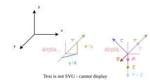

# Aircraft Kinematics — Equations of Motion

## 1. State Vector and Aircraft Maximum Constraints

### 1.1 State Vector
Each aircraft is represented as a point in space with the following state vector:

$$
\mathbf{s}(t) = \begin{pmatrix} x(t) \\ y(t) \\ h(t) \\ v(t) \\ \gamma(t) \\ \chi(t) \end{pmatrix}
$$

| Symbol   | Description                                                       | Unit                                                        |
|----------|-------------------------------------------------------------------|-------------------------------------------------------------|
| $x$      | East position (Cartesian)                                         | $[\text{m}]$                                                |
| $y$      | North position (Cartesian)                                        | $[\text{m}]$                                                |
| $h$      | Altitude (MSL)                                                    | $[\text{m}]$                                                |
| $v$      | True airspeed                                                     | $[\text{m/s}]$ or $[\text{kts}]$ $\Rightarrow$ scalar value |
| $\gamma$ | Flight path angle (Flugbahnwinkel)                                | $[°]$                                                       |
| $\chi$   | Track angle / Course angle (Kursbahnwinkel) from North, clockwise | $[°]$                                                       |

> **Assumption (coordinated flight):** The aircraft is modelled as a point mass. No sideslip angle — the nose always points in the direction of motion. Therefore no separate heading angle is needed. The track $\chi$ is fully determined by the start–end geometry.

### 1.2 Aircraft Maximum Constraints
| Symbol            | Description                                    | Unit                                                        |
|-------------------|------------------------------------------------|-------------------------------------------------------------|
| $v_{min}$         | min speed                                      | $[\text{m/s}]$                                              |
| $v_{max}$         | max speed                                      | $[\text{m/s}]$                                              |
| $roc_{max}$       | max rate of climb                              | $[\text{m/s}]$                                              |
| $rod_{max}$       | max rate of decent                             | $[\text{m/s}]$ or $[\text{kts}]$ $\Rightarrow$ scalar value |
| $gammadot_{maxg}$ | max change of the flight path angle per second | $[°/s]$                                                     |
| $chidot_{max}$    | max change of course angle per second          | $[°/s]$                                                     |

---

## 2. Angle Definitions

### 2.1 Flight Path Angle $\gamma$ (vertical plane)

The flight path angle describes the inclination of the velocity vector relative to the horizontal:

$$
\gamma > 0 \quad \Rightarrow \quad \text{climb (Steigflug)}
$$
$$
\gamma < 0 \quad \Rightarrow \quad \text{descent (Sinkflug)}
$$
$$
\gamma = 0 \quad \Rightarrow \quad \text{level flight (Horizontalflug)}
$$

Vertical and horizontal speed components:

$$
v_z = v \cdot \sin(\gamma) \qquad \text{(Rate of Climb / Descent per time)} \;\; [m/s]
$$

$$
v_{h} = v \cdot \cos(\gamma) \qquad \text{(horizontal ground speed component)} \;\; [m/s]
$$

### 2.2 Track Angle $\chi$ (horizontal plane)

The track angle is measured clockwise from True North:

$$
\chi = 0° \Rightarrow \text{North}, \quad \chi = 90° \Rightarrow \text{East}, \quad \chi = 180° \Rightarrow \text{South}, \quad \chi = 270° \Rightarrow \text{West}
$$

Decomposition of horizontal speed into East / North components:

$$
v_E = v \cdot \cos(\gamma) \cdot \sin(\chi)
$$

$$
v_N = v \cdot \cos(\gamma) \cdot \cos(\chi)
$$

---

## 3. Equations of Motion (Continuous Time)

For a flat-Earth approximation in Cartesian coordinates $(x, y, h)$ with $x$ = East, $y$ = North:

$$
\dot{x}(t) = v \cdot \cos(\gamma) \cdot \sin(\chi)
$$

$$
\dot{y}(t) = v \cdot \cos(\gamma) \cdot \cos(\chi)
$$

$$
\dot{h}(t) = v \cdot \sin(\gamma)
$$

The speed $v$ and angles $\gamma$, $\chi$ are treated as **control inputs** (actions) of the model. Within a single discrete timestep they are held constant (zero-order hold).

---

## 4. Basic Definitions of the aerodynamic kinetic model

As describes above the state vector for each aircraft:
$
\begin{bmatrix}
x \\
y \\
z \\
v \\
\gamma \\
\chi
\end{bmatrix}
$

$
\vec{v} = v \cdot
\begin{bmatrix}
\cos(\gamma)\cos(\chi) \\
\cos(\gamma)\sin(\chi) \\
\sin(\gamma)
\end{bmatrix}
$

Base definition of the aircraft:
- Trust: \(T\)  
- Drag: \(D\)  
- Lift: \(L\)  
- Gravitation: \(mg\)

Basic definitions:
$
\vec{g} = \begin{bmatrix}
0 \\
0 \\
1
\end{bmatrix} \cdot g = \begin{bmatrix}
0 \\
0 \\
g
\end{bmatrix}
$

Force equation:

$
F = m \cdot a
$

$
F = m \cdot \vec{v}
$

$
m \cdot \vec{v} = (T - D) \cdot \frac{\vec{v}}{\|\vec{v}\|} + L \cdot \vec{n} + m \cdot \vec{g} \quad note: F := \frac{\vec{v}}{\|\vec{v}\|}
$

this can also be written as:
$
\dot{v} = \frac{T - D}{m} \cdot \frac{\vec{v}}{\|\vec{v}\|} + \frac{L}{m} \cdot \vec{n} + \vec{g}
 = g \cdot (n_x \cdot t + n \cdot \vec{n} + \begin{bmatrix} 0 \\ 0 \\ 1 \end{bmatrix}), \quad \vec{v} = v \cdot F
$

$\vec{n}$ is defined as follows:
$
\vec{n} = \frac{\vec{L}}{\|\vec{L}\|}
$

but we can also get $\vec{n}$ as follow

$
\vec{t} = \frac{\vec{v}}{\|\vec{v}\|}, \quad
\vec{u} = 
\begin{bmatrix}
0 \\
0 \\
1
\end{bmatrix}, \quad
\vec{b} = \frac{\vec{t} \times \vec{u}}{\|\vec{t} \times \vec{u}\|}, \quad
\vec{n} = \vec{b} \times \vec{L}, \quad
and \quad so: \quad \vec{L} \perp \vec{v}
$

but we also need to consider the $\phi$ roll of the airplane:

so 
$
\vec{L} \perp \vec{\phi} \rightarrow
\vec{n}_{rot} = \vec{n} \cdot \cos{\phi} + (\vec{t} \times \vec{n}) \cdot \sin{\phi} + \vec{t} \cdot (\vec{t} \cdot \vec{n}) \cdot (1 - \cos{\phi})
$ 

load factor n is defined as follows:
$
n = \frac{L}{m \cdot g} \rightarrow \dot{v} = \frac{\sum \cdot F}{m} \rightarrow \dot{v_n} = \frac{L}{m} \rightarrow 
n = \frac{\dot{v_n}}{g} = \frac{L}{m \cdot g}
$

### which factors can be influenced by the pilot of the aircraft ?
1. thrust $T$
2. old: flight path angle $ \rightarrow \gamma$, new: the load factor $n = \frac{\dot{v_n}}{g} = \frac{L}{m \cdot g}$ , so $L = n \cdot m \cdot g$
3. roll of the aircraft $\phi$ e.g. $\chi = \frac{g \cdot \tan(\phi)}{v} \rightarrow \frac{g \cdot \tan(\phi)}{v} \cdot \triangle t$ where t denotes the time in seconds

Aerodynamic model:

$
D = \frac{1}{2} \rho v^2 C_D A
$

$
L = \frac{1}{2} \rho v^2 C_L A
$

$
C_L \rightarrow C_L(\alpha) = C_{L_\alpha} \cdot \alpha + C_{L_0}
$ because we habe a directed flight, $\alpha$ is always 0

$
C_D = C_{D_0} + k \cdot C_L^2
$

$
\rho(h)=\rho_0 e^{-\frac{h}{H}}
$

$
C_L = \frac{2 n m g}{\rho v^2 S}
$

where:

- $\rho$ air density $[kg/m^3]$
- $v$ aircraft speed $[m/s]$
- $C_D$ drag coefficient
- $C_L$ lift coefficient
- $A$ reference / wing area $[m^2]$
- $C_{L_0}$: $C_L$ value for $\alpha = 0$
- $C_{L_\alpha}$: slope of the $C_L$ curve

## 5. ready point mass flight model as a discrete model:

$
\dot{v}
=
\begin{bmatrix}
\dot v_x \\
\dot v_y \\
\dot v_z
\end{bmatrix}
$

$
\dot{v} = \frac{T - D}{m} \cdot \frac{\vec{v}}{\|\vec{v}\|} + \frac{L}{m} \cdot \vec{n} + \vec{g}
$

$
\dot v_x = \frac{T-D}{m}\cos(\gamma)\cos(\chi) + \frac{L}{m}n_x
$

$
\dot v_y = \frac{T-D}{m}\cos(\gamma)\sin(\chi) + \frac{L}{m}n_y
$

$
\dot v_z = \frac{T-D}{m}\sin(\gamma) + \frac{L}{m}n_z - g
$

$
\begin{bmatrix}
\dot v_x \\
\dot v_y \\
\dot v_z
\end{bmatrix} =
\frac{T-D}{m}
\begin{bmatrix}
\cos(\gamma)\cos(\chi) \\
\cos(\gamma)\sin(\chi) \\
\sin(\gamma)
\end{bmatrix} +
\frac{L}{m}
\begin{bmatrix}
n_x \\
n_y \\
n_z
\end{bmatrix} +
\begin{bmatrix}
0 \\
0 \\
-g
\end{bmatrix}
$

$
\dot{\chi} = \frac{g \cdot tan(\phi)}{v}
$ see definition of $\phi$ above

$
\dot{\gamma}
=
\frac{v \, \dot{v}_z - v_z \, \dot{v}}{v_h^2}
$

for now we define the update of the state in discrete steps not in continuous, so the position update.

for that we define the change of time of the position as the velocity:
$
\mathbf{p} =
\begin{bmatrix}
x \\
y \\
h
\end{bmatrix},
\qquad
\mathbf{v} =
\begin{bmatrix}
v_x \\
v_y \\
v_z
\end{bmatrix}
\rightarrow
\dot{\mathbf{p}} = \mathbf{v}, \qquad
\dot{x} = v_x, \qquad
\dot{y} = v_y, \qquad
\dot{h} = v_z
$

next we formulate the state update as an euler step:

$
\vec{x}_{k+1} = \vec{x}_{k} + \dot{v} \cdot \Delta t
$

so for every component in the current state p we multiply the change of $\vec{x}_{k+1}$

$
\vec{p}_{k+1} = \vec{p}_{k} + \vec{x}_{k+1} \cdot \Delta t
$

Flight path angle update

$
\Delta \gamma = \gamma_{command-input} - \gamma_{current-state} \rightarrow \gamma_{command-input} - \gamma
$

$
\gamma_{k + 1} = \gamma_{k} - \Delta \gamma
$

State reconstruction from velocity

$
v = \|\vec{v}\|
$

$
\gamma = arcsin(\frac{v_z}{v})
$

$
\chi = atan2(v_x, v_y)
$

State generation via derivation:

$
\dot{\chi} = \frac{g \cdot tan(\phi)}{v}
$ see definition of $\phi$ above

$
\dot{\chi_{k + 1}} = \chi_k + \dot{\chi}  \cdot \Delta t
$

$
\dot{\gamma}
=
\frac{v \, \dot{v}_z - v_z \, \dot{v}}{v_h^2}
$

$
\dot{\gamma_{k + 1}} = \gamma_k + \dot{\gamma}  \cdot \Delta t
$
---

## 6. Inverse Problem, start and end are given:

find:
1. thrust $T$
2. flight path angle $ \rightarrow \gamma$
3. roll of the aircraft $\phi$

where:
$
T = const
\qquad
\gamma = const
\qquad
\phi = const
$

Known quantities:
initial state
$
\mathbf{s}_0 =
\begin{bmatrix}
x_0 \
y_0 \
h_0 \
v_0 \
\gamma_0 \
\chi_0
\end{bmatrix}
$

goal state
$
\mathbf{s}_{goal} =
\begin{bmatrix}
x_g \
y_g \
h_g \
v_g \
\gamma_g \
\chi_g
\end{bmatrix}
$

fixed flight time
$
T_f
$

### solution 

Thrust
$
T = m \left( \dot{\vec{v}} \cdot \vec{t} \right) + D
$

Load factor
$
n = \frac{(\dot{\vec{v}} - \vec{g}) \cdot \vec{n}}{g}
$

Roll angle
$
\phi = \arctan\left(\frac{v \, \dot{\chi}}{g}\right)
$